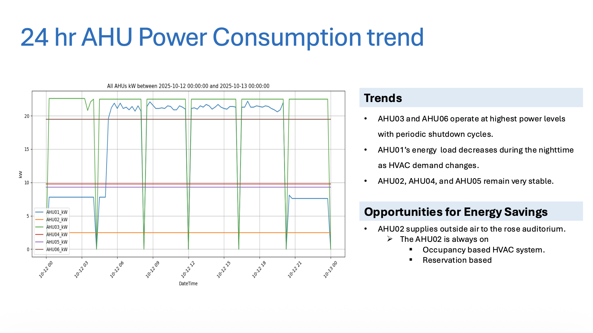
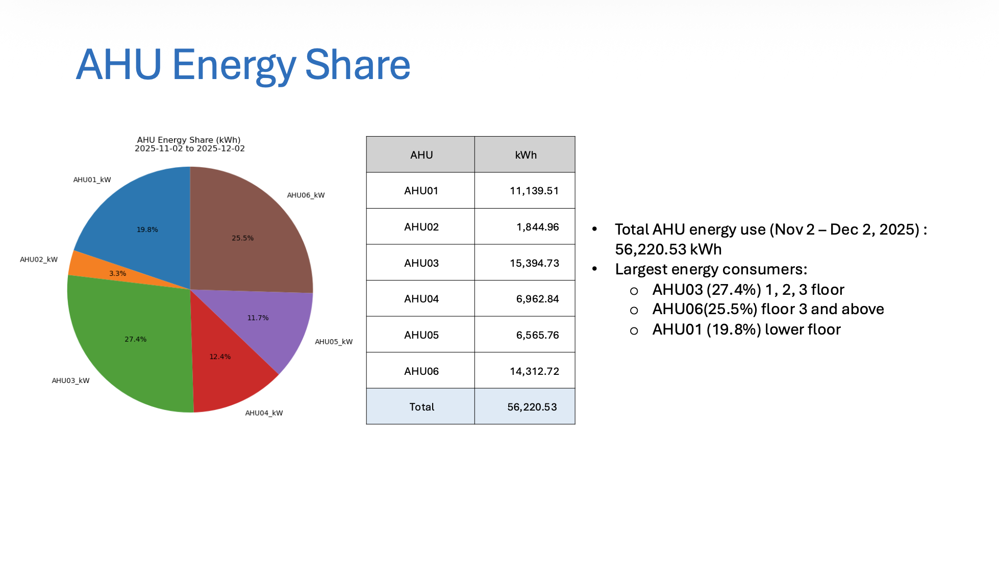
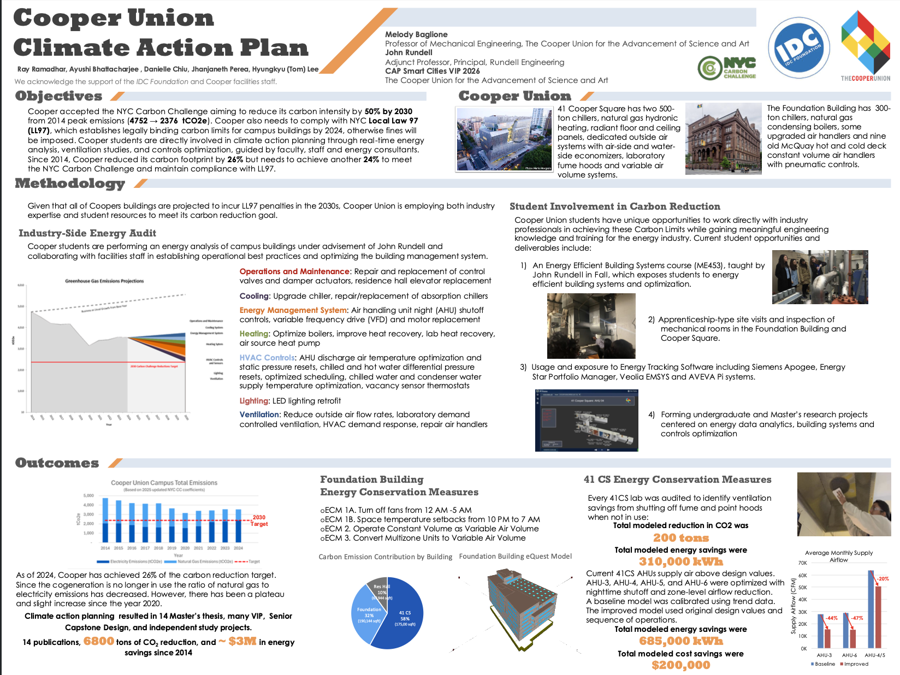
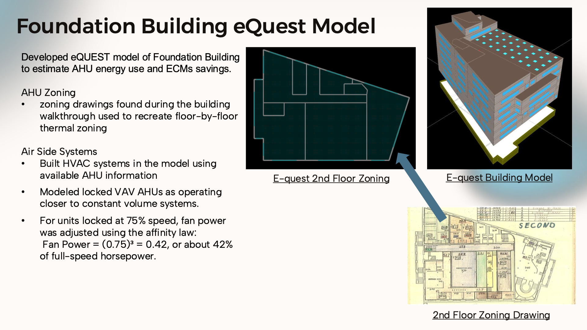
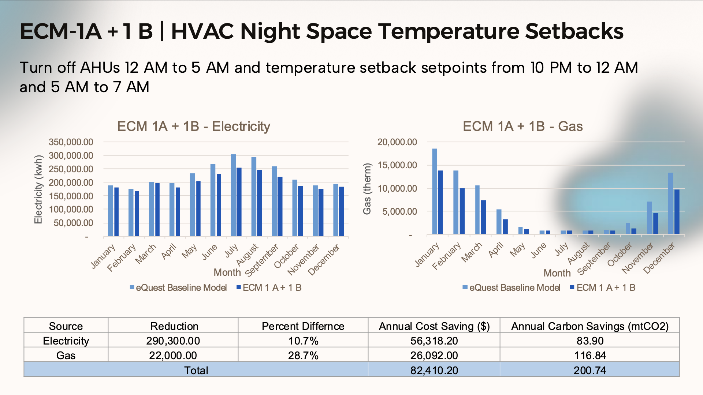
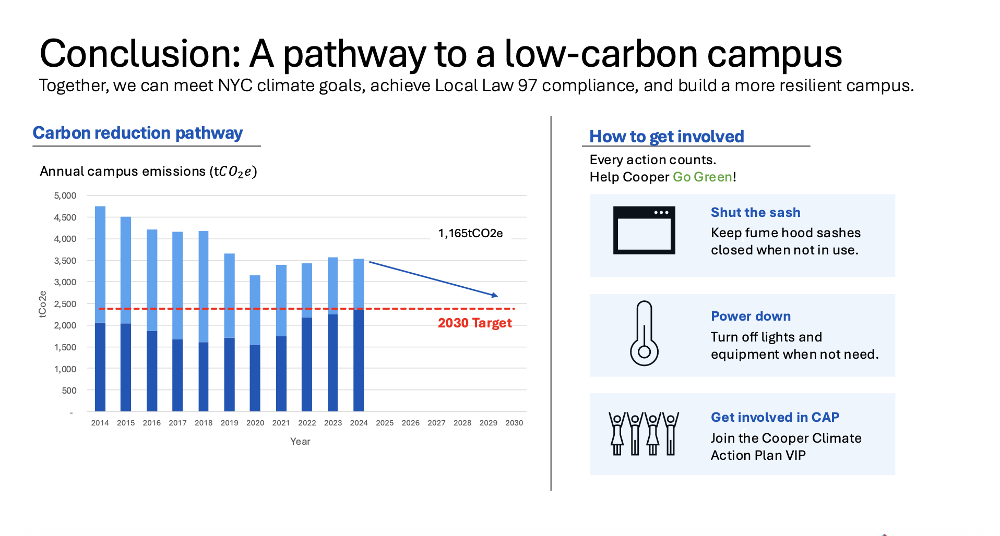
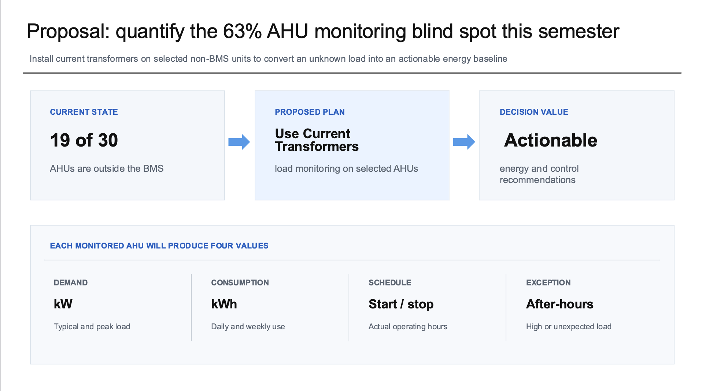
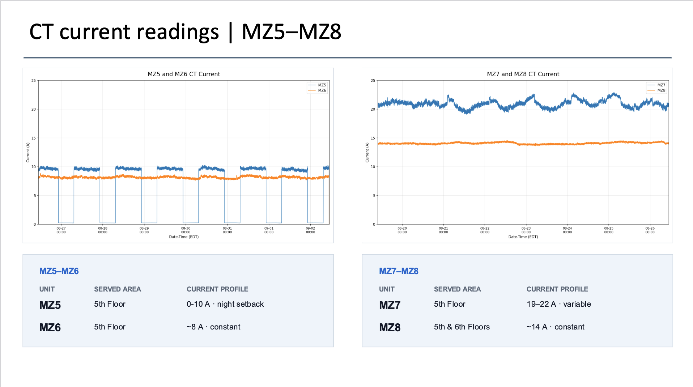

# Building Energy & Carbon Analysis
exp
## 1. Building Energy & Carbon Analysis
*Vertically Integrated Projects · Fall 2025*

  
  &nbsp;&nbsp;
  

### Description
Analyzed HVAC energy use and carbon emissions at Cooper Union’s 41 Cooper Square using building management system (BMS) and utility data. Identified energy-saving opportunities and proposed occupancy-based controls to improve efficiency and reduce operating costs.

### What I Did
- Aggregated power measurements from six air handling units into 15-minute intervals and compared their energy consumption and operating patterns.
- Examined utility records and electricity emissions factors to understand building carbon emission trends.

### Key Findings
- AHU03 and AHU06 accounted for approximately 53% of the monitored AHU energy consumption.
- The auditorium AHU operated continuously during the observed period, suggesting an opportunity for occupancy- or reservation-based scheduling.

### Methods
BMS time-series analysis, interval averaging, energy consumption calculations, utility benchmarking, and carbon emissions analysis.

#### 📄 [View Full Project Final Presentation](documents/F25-VIP.pdf)

---

## 2. Foundation Building Energy Modeling
*Independent Study & Vertically Integrated Projects · Spring 2026*

**Selected as an IDC Foundation Innovation Fellow, with work supported by the IDC Foundation.**

  
  &nbsp;&nbsp;
  

  
  &nbsp;&nbsp;
  

### Description
Developed an eQUEST energy model of Cooper Union’s historic Foundation Building using HVAC field surveys and utility data. Evaluated scheduling changes, temperature setbacks, and airflow control upgrades to estimate energy savings, emissions reductions, and retrofit payback.

### What I Did
- Recreated building thermal zones and HVAC systems in eQUEST using floor plans, equipment information, and field observations.
- Compared simulated electricity and natural gas consumption with utility data and evaluated alternative HVAC operating strategies.
- Implemented energy conservation measures (ECMs) in the eQuest model to quantify energy savings and emissions reductions.
- Made poster and presentation to present to the Cooper Union community of professors, students and facilitis staff.

### Key Findings
- Field observations identified variable air volume units operating at fixed speeds, revealing opportunities for improved airflow control.
- A combined nighttime shutdown and temperature setback scenario projected approximately $82,400 in annual energy cost savings and 201 metric tons of annual CO₂e reductions. These are modeled savings, not measured outcomes.

### Methods
eQUEST whole-building energy simulation, thermal zoning, HVAC field surveys, utility data comparison, scenario analysis, and simple payback calculations.

#### 📄 [View Facilities Staff Final Presentation](documents/S26-IS.pdf)
#### 📄 [View Faculty and Student Final Presentation](documents/S26-VIP.pdf)
#### 📄 [View Community Poster](documents/S26-VIP-Poster.pdf)

---

## 3. BEAM: Building Energy Monitoring & Forecasting
*Senior Capstone · Fall 2026–Present · In Progress*

### Description
Developing data pipelines, an energy dashboard, and a machine learning model for Cooper Union’s 41 Cooper Square. Integrating historical and current building data to forecast energy demand and help facilities staff evaluate building performance.

### What I Did
- Contributing to the legacy data workstream, focusing on data pipeline restoration, dashboard development, and energy forecasting.
- Planning the integration of historical energy records, incoming building data, and weather information to support monitoring and load prediction.

### Key Findings
- Existing monitoring systems contain fragmented data streams, aging hardware, and unsupported software, limiting consistent access to building energy information.
- Building-level utility records provide limited visibility into individual equipment operation, motivating a more integrated monitoring platform.

### Methods
Data pipeline and database design, API-based data integration, time-series analysis, dashboard development, and weather-informed machine learning forecasting. Implementation and model evaluation are ongoing.

---

## 4. Foundation Building AHU Monitoring
*Vertically Integrated Projects · Fall 2026–Present · In Progress*

  
  &nbsp;&nbsp;
  

### Description
Investigating HVAC operation in Cooper Union’s Foundation Building, focusing on air handling units outside the building management system (BMS) network. Using field inspections and current measurements to identify monitoring gaps and opportunities for more efficient operation.

### What I Did
- Documented AHU types, served spaces, and BMS connectivity through field inspections and equipment inventory reviews.
- Analyzed current transformer measurements from multizone AHUs to compare operating schedules and electrical current profiles.

### Key Findings
- 19 of the building’s 30 inventoried AHUs were not connected to the BMS, limiting visibility into their operation.
- Several monitored units remained energized throughout most of the recording period.
- MZ-5 showed a distinct nighttime setback, while other units maintained relatively constant current levels.

### Methods
HVAC field inspections, equipment inventory review, current transformer sensing and data logging, time-series visualization, and operating schedule analysis.

#### 📄 [View Proposal](documents/F26-VIP.pdf)